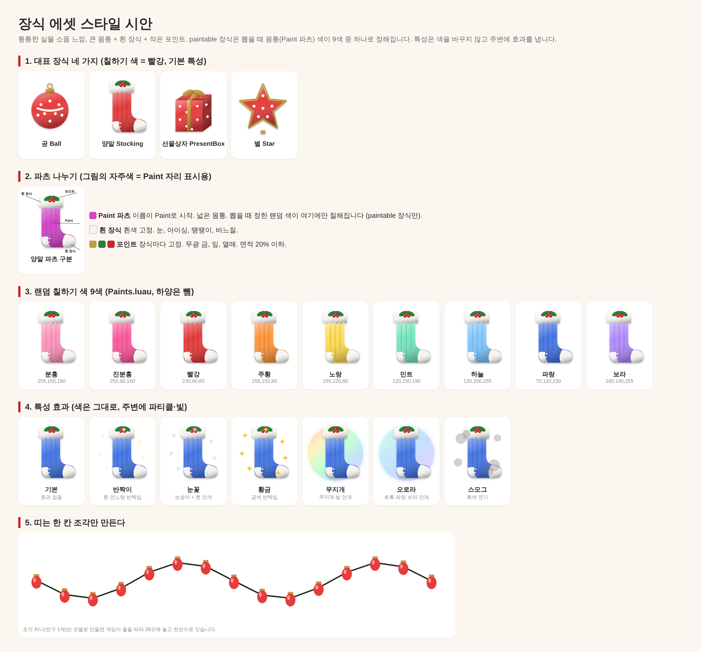

# 장식 3D 에셋 규칙

장식 모델을 만들 때 지키는 규칙. 그림 시안: `docs/asset_rules/style_sheet.png`
(시안 다시 그리기: `python3 tools/asset_style_sheet.py out.html` 후 브라우저로 열기)

---

## 1. 스타일

- **통통한 실물 소품 느낌.** 도자기 오너먼트, 니트 양말, 아이싱 쿠키처럼 모서리가 둥글고 덩어리가 큼직하다.
- **구조는 "큰 몸통 하나 + 흰 장식 + 작은 포인트".** 몸통이 실루엣의 대부분을 차지한다.
- 니트 줄무늬, 바느질처럼 **형태로 표현할 수 있는 무늬는 메시 요철로** 만든다. 색으로 그리지 않는다 (몸통 색이 바뀌어도 무늬가 남도록).
- 재질은 SmoothPlastic 기준으로 만든다. 특성 효과가 재질을 바꾼다(아래 4번).
- **최대한 로우폴리.** 둥근 느낌은 면 수가 아니라 큼직한 덩어리와 모서리 깎기로 낸다. 트리 하나에 장식이 수십 개, 서버에 트리가 여러 개 있다.
- **텍스처를 쓰지 않는다.** 색은 파츠 색(`Color`)으로만 칠한다. 특히 `Main` 파츠에 `TextureID`나 `SurfaceAppearance`가 있으면 게임이 칠한 색이 보이지 않는다.
- **등급은 모양에 표시하지 않는다.** 장식 종류가 곧 등급이므로, 높은 등급 장식은 형태 자체를 더 화려하게 만든다.

## 2. 파츠 나누기 (색칠 규칙)

모든 장식 모델은 파츠를 아래 세 이름 중 하나로 시작하게 짓는다. (예: `Main`, `Main_Toe`, `Trim_Cuff`, `Accent_Leaf`)

| 구분 | 색 | 넣는 곳 | 면적 |
| --- | --- | --- | --- |
| `Main` | **뽑을 때 정한 랜덤 색** (3번 팔레트) + 특성 효과 | 넓은 몸통 | 50% 이상 |
| `Trim` | 흰색 고정 `(246, 244, 239)` | 눈, 아이싱, 땡땡이, 바느질, 방울 | 자유 |
| `Accent` | 장식마다 고정 | 무광 금 테두리, 잎, 열매, 리본 | 20% 이하 |

- 게임은 이름이 `Main`으로 시작하는 파츠의 색과 재질만 바꾼다 (`TreeService.luau`의 `paintModel`). `Main` 파츠가 하나도 없으면 Output에 경고가 나온다. `Trim`, `Accent`는 Studio에서 칠한 그대로 둔다.
- `Main`과 `Accent`가 바로 맞닿지 않게 사이에 `Trim`을 두는 것을 권장한다. 몸통이 어떤 색이 나와도 포인트가 묻히지 않는다.
- `Accent`에 쓰는 색 (권장): 무광 금 `(196, 154, 72)`, 잎 `(47, 125, 59)`, 열매 `(200, 38, 44)`.
  - 무광 금은 **황금 특성의 금색 `(255, 200, 40)`과 구분되도록** 어둡고 탁하게 유지한다. 시안 4-1의 황금 선물상자처럼 리본이 몸통에 묻히는 일이 생기므로, 금 Accent는 가늘게만 쓴다.
- 캐릭터 키링(뉴비, 트랄랄레로 등)처럼 원래 색이 정해진 장식은 **모델 전체를 `Accent`로** 두고 고리·받침만 `Main`으로 둔다. (얼굴 색이 랜덤으로 바뀌면 캐릭터를 못 알아보기 때문)

## 3. 랜덤 메인 색 팔레트 (8색)

목록 파일: `src/shared/Catalog/Colors.luau`

- 뽑기 결과로 **서버가** 이 중 하나를 **같은 확률**로 정하고 저장한다.
- 색은 **가치에 영향을 주지 않는다.** 가방에서는 색이 다르면 다른 칸이 된다.
- 흰색·금색은 `Trim`, 황금 특성과 겹치므로 넣지 않는다.

| id | 이름 | RGB |
| --- | --- | --- |
| `Red` | 빨간 | 200, 42, 48 |
| `DeepGreen` | 진초록 | 30, 112, 62 |
| `LightGreen` | 연초록 | 122, 190, 92 |
| `Navy` | 남색 | 38, 58, 124 |
| `SkyBlue` | 하늘색 | 118, 184, 230 |
| `Purple` | 보라 | 132, 82, 172 |
| `Pink` | 분홍 | 240, 140, 172 |
| `Brown` | 갈색 | 150, 96, 56 |

- 색 `id`도 장식·특성 `id`처럼 **출시 후 바꾸거나 지우지 않는다.** 그만 나오게 하려면 `retired = true`.

## 4. 특성 효과 (`Main`에만 적용)

`TreeService.luau`의 `applyTrait`와 같은 내용이다.

| 특성 | `Main`에 하는 일 |
| --- | --- |
| 기본 | 팔레트 색 그대로 |
| 반짝이 | 색 유지 + 반짝임 |
| 눈꽃 | 흰색 45% 섞기, 얼음 재질 |
| 황금 | 금색 `(255, 200, 40)`, 금속 재질 + 반짝임 (팔레트 색 무시) |
| 무지개 | 네온, 색이 계속 바뀜 (팔레트 색 무시) |
| 오로라 | 네온 민트 `(120, 255, 200)` + 빛 (팔레트 색 무시) |
| 스모그 | `applyTrait`에 아직 `Smoge` 분기가 없어 몸통 색만 보인다 |

## 5. 크기·붙는 자리

- 기준 크기: 오너먼트 지름 약 1.4 스터드, 토퍼 약 2.4 스터드 (지금 임시 공 크기와 같음).
- 모델의 Pivot = 트리에 걸리는 점. 오너먼트는 고리 끝, 토퍼는 밑면 가운데.
- 띠(`Garland`)는 아직 모델 규칙 없음. 지금은 전구 공을 이어 그린다.

---

## 정해진 것

- 메인 색은 가치에 영향 없음
- 8색은 같은 확률
- 등급은 모양에 표시하지 않음 (장식 종류가 등급)
- 폴리곤·텍스처: 최대한 로우폴리, 텍스처 없음

## 코드 연결

- 색 목록: `src/shared/Catalog/Colors.luau`, 뽑기: `Catalog.RollColor`
- 저장: 가방 칸 `{ d, t, col, c, l }`, 트리 `{ a, i, d, t, col }` (`PlayerData.luau`, 데이터 버전 3). 색이 없는 예전 데이터는 불러올 때 칸마다 색을 하나 뽑아 준다.
- 칠하기: `TreeService.luau`의 `paintModel`(모델), `decorateLook`(모델이 없을 때 임시 공)
- 화면 이름: `GachaUI.luau`의 `itemName` ("황금 남색 양말")
