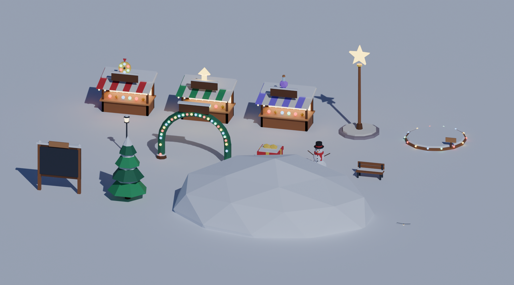

# 맵 에셋 목록 (크리스마스 마켓 광장)

맵 구상: `docs/MAP_CONCEPT.md`. Studio에서 맵을 만드는 방법: `docs/MAP.md`.

- 파일: `assets/models/map/` (에셋마다 `.fbx` 하나, 전부 모은 `MapAssets.blend`)
- 만드는 스크립트: `tools/blender/make_map_assets.py` (모양·색·크기를 바꾸려면 여기를 고치고 다시 실행)
- 스타일: 로우폴리, 텍스처 없음, 색 하나 = 파트 하나

## 목록

크기는 스터드 (폭 x 깊이 x 높이). 캐릭터 키가 약 5, 트리가 폭 13 x 높이 18이다.

| 파일 | 무엇 | 크기 | 삼각형 | 개수 (맵에 놓는 수) |
| --- | --- | --- | --- | --- |
| `StallRoulette` | 룰렛 가게 (빨강 차양, 돌림판) | 16 x 10 x 17 | 724 | 1 |
| `StallUpgrade` | 업그레이드 가게 (초록 차양, 화살표) | 16 x 10 x 17 | 556 | 1 |
| `StallPotion` | 물약 가게 (보라 차양, 물약병) | 16 x 10 x 17 | 604 | 1 |
| `StarPole` | 가운데 별 기둥 (스폰) | 12 x 12 x 27 | 212 | 1 |
| `PlotBase` | 트리 자리 단 (눈 덮인 둥근 단, 전구, 이름표 말뚝) | 18 x 18 x 4 | 408 | 10 |
| `LampPost` | 가로등 | 2 x 2 x 12 | 108 | 10~12 |
| `PhotoArch` | 포토존 전구 아치 | 23 x 3 x 19 | 976 | 1 |
| `GiftBox` | 큰 선물상자 | 6.5 x 6.5 x 7.5 | 120 | 2~4 (색 바꿔서) |
| `Snowman` | 눈사람 | 7 x 5 x 10 | 538 | 1~2 |
| `Bench` | 벤치 | 8 x 3 x 4 | 144 | 2~4 |
| `Leaderboard` | 리더보드 판 | 14 x 2 x 16 | 92 | 1 |
| `PineTree` | 숲 나무 | 12 x 12 x 20 | 116 | 60~100 (크기 섞어서) |
| `SnowHill` | 눈 언덕 | 59 x 43 x 17 | 64 | 2~3 |
| `StringLight` | 전구 줄 한 칸 | 4 x 0.5 x 1 | 64 | 필요한 만큼 (또는 Beam으로 대신) |

Blender로 만들지 않는 것 (Studio 파트로 충분):

- 광장 바닥, 돌길(가운데 광장·세 갈래 길·둘레길), 눈밭: 원기둥·쐐기 파트
- 밤하늘·조명: Lighting 설정 (ClockTime, Atmosphere)
- 눈 내리는 효과: ParticleEmitter
- 간판 글자(룰렛, 업그레이드, 물약, 포토존)와 리더보드 내용: SurfaceGui

## Studio에 넣는 법

1. **Home → Import 3D**로 `assets/models/map/`의 `.fbx`를 고른다.
2. 가져오기 창에서 크기 단위를 **Stud**로 맞춘다. 가져온 뒤 크기가 위 표와 다르면 표에 맞게 조절한다.
3. 에셋 하나가 Model 하나로 들어온다. 안의 파트 이름은 `에셋이름_색이름`이다 (예: `StallRoulette_Wood`).
4. 색이 안 들어왔으면 파트 이름의 색을 보고 `Color`를 칠한다. 색 값은 스크립트 위쪽 `COLORS` 표에 있다.
5. 이름에 **`Glow`가 들어간 파트**(전구, 불 켜진 창, 별)는 `Material`을 **Neon**으로 바꾼다. 가로등·별 기둥에는 PointLight를 넣는다.
6. 모든 파트는 `Anchored`를 켠다. 사람이 지나가야 하는 작은 것(전구, 눈)은 `CanCollide`를 끈다.
7. 맵은 플레이스 파일에 저장된다 (`Cmd + S`).

## 방향·원점

- 원점은 바닥 가운데. 땅 위에 그대로 놓으면 된다.
- 앞면은 Studio의 Front(-Z). 가게는 판매대 쪽, 리더보드는 화면 쪽, 트리 자리 단은 이름표 말뚝이 있는 쪽이 앞이다.
- `PlotBase`를 놓을 때는 `docs/MAP.md`의 트리 자리 표시(`PlotSpots`)와 같은 자리·방향으로 맞춘다. 트리는 단 가운데에 선다 (단 윗면 높이 1.2).
