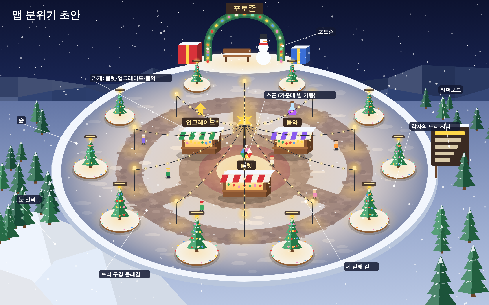

# 맵 구상 (크리스마스 마켓 광장)

분위기 초안: `docs/map_concept.png` (다시 그리기: `python3 tools/map_concept.py out.html` 후 브라우저로 열기)
맵을 Studio에서 만드는 방법(트리 자리 표시 등)은 `docs/MAP.md`.

## 정해진 것

- **시간대**: 밤. 전구와 가게 불빛이 따뜻하게 보이게 한다.
- **스타일**: 로우폴리. 장식 에셋 규칙(`docs/ASSET_RULES.md`)과 같은 통통하고 각진 느낌.
- **모양**: 눈 쌓인 숲에 둘러싸인 동그란 광장.
- **가운데**: 스폰(큰 별 기둥). 그 둘레에 가게 3곳: 룰렛, 업그레이드, 물약.
- **길**: 가운데 광장에서 세 갈래 길이 가게 사이로 나가고, 트리 자리 앞을 한 바퀴 도는 둘레길로 이어진다. 걸으면서 트리를 차례로 구경한다.
- **트리 자리**: 광장 둘레에 10곳 (`SERVER_MAX_PLAYERS`). 각자 눈 덮인 둥근 단 위에 트리가 선다.
- **위쪽**: 포토존 (전구 아치, 벤치, 눈사람, 큰 선물상자).
- **오른쪽**: 리더보드. **왼쪽 아래**: 눈 언덕. **바깥**: 숲.
- 가운데 별 기둥에서 둘레길 가로등까지 전구 줄을 방사형으로 건다.

## 만들 때 주의

- 트리 앞 14스터드에 사람이 나타난다. 둘레길이 그 자리이므로 길 폭을 넉넉히 잡고 부스·벽을 두지 않는다.
- 트리끼리 중심 간격은 24스터드 이상 (사이로 지나갈 수 있게).
- Roblox 게임 설정의 서버 최대 인원도 10으로 맞춘다.
